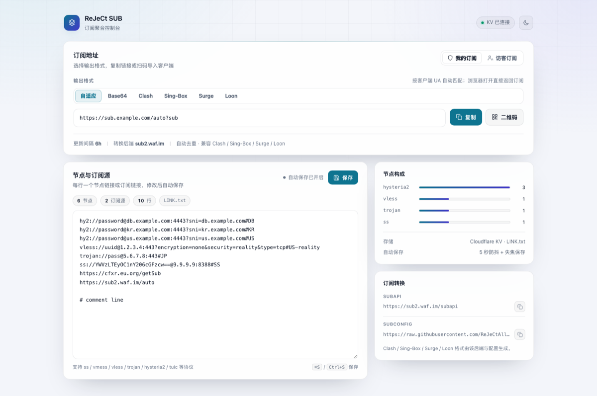

# CFnode

把自建节点与多个订阅汇聚成一条订阅链接，运行在 Cloudflare Workers / Pages 上，附带一个可在线编辑的订阅管理面板。

> 本项目是 [cmliu/CF-Workers-SUB](https://github.com/cmliu/CF-Workers-SUB) 的个人定制分支。相比上游，主要改动了管理面板 UI、订阅转换后端与分流配置，并停用了上游自动同步。



## 功能

- **多源聚合**：节点链接与 Base64 / Clash / Sing-Box 订阅可以混在同一个列表里，输出时自动去重。
- **一条链接适配多种客户端**：按 UA 自适应，也可以用 `?b64`、`?clash`、`?sb`、`?surge`、`?loon` 显式指定格式。
- **订阅转换**：Clash / Mihomo、Sing-Box、Surge、Loon 配置由订阅转换后端生成，分流规则由 `SUBCONFIG` 控制。
- **在线编辑**：浏览器打开 `/<TOKEN>` 进入管理面板，直接编辑 KV 里的 `LINK.txt`；支持自动保存、`⌘S` / `Ctrl+S`、节点统计与协议分布。
- **访客订阅**：可选的 `GUEST` token，只能拉取订阅，不能进入管理面板。
- **深色 / 浅色主题**：跟随系统，也可以手动切换并记住选择。
- **访问伪装**：未授权访问可以 302 到指定地址、反代到指定站点，或返回 nginx 默认页。
- **Telegram 通知**：获取订阅、编辑配置、异常访问都可以推送到 Telegram。

## 请求流程

```text
Client (Clash / Sing-Box / Surge / Loon / v2rayN)
        │  GET /<TOKEN>?clash
        ▼
Cloudflare Worker (_worker.js)
        ├─ 读取 KV: LINK.txt（节点链接 + 订阅链接）
        ├─ 并行拉取订阅源（2s 超时）
        ├─ 解码 Base64 / Clash / Sing-Box，归一化为节点列表
        ├─ Base64 直出，或交给订阅转换后端
        │    SUBAPI + SUBCONFIG → Clash / Sing-Box / ...
        ▼
Client
```

## 快速开始

### 1. 创建 KV

在 Cloudflare 控制台创建一个 KV Namespace，用于保存 `LINK.txt`。

### 2. Pages（Git 集成）

1. Fork / clone 本仓库并推送到 GitHub。
2. Cloudflare Dashboard → Workers & Pages → Create → Pages → Connect to Git，选择本仓库。
3. Framework preset 选择 `None`，构建命令留空，构建输出目录填 `/`（仓库根目录）。
4. 项目 Settings → Functions → KV namespace bindings，添加：
   - Variable name: `KV`
   - KV namespace: 第 1 步创建的空间
5. Settings → Environment variables 添加至少 `TOKEN`。
6. 重新部署，访问 `https://<你的域名>/<TOKEN>`。

也可以直接上传仓库根目录：

```bash
wrangler pages deploy . --project-name <your-pages-project>
```

### 3. Workers

1. 新建 Worker，把 `_worker.js` 的内容粘贴进去，或使用 `wrangler deploy`。
2. Settings → Bindings → Add → KV Namespace，变量名填 `KV`。
3. Settings → Variables and Secrets 添加至少 `TOKEN`。
4. 访问 `https://<worker>.<subdomain>.workers.dev/<TOKEN>`。

### 4. wrangler

```bash
npm install -g wrangler
wrangler login
```

编辑 `wrangler.toml`，取消 KV 绑定注释并替换 namespace id：

```toml
name = "sub-worker"
main = "_worker.js"
compatibility_date = "2025-07-23"
keep_vars = true

[[kv_namespaces]]
binding = "KV"
id = "<your-kv-namespace-id>"
```

```bash
wrangler deploy
```

> `wrangler.toml` 里的 KV 绑定默认是注释状态；不配置绑定，Worker 不会出现管理面板。

## 访问路径

| 路径 | 说明 |
| --- | --- |
| `/<TOKEN>` | 浏览器：管理面板；订阅客户端：按 UA 自适应 |
| `/<TOKEN>?b64` | Base64 节点列表 |
| `/<TOKEN>?clash` | Clash / Mihomo |
| `/<TOKEN>?sb` | Sing-Box |
| `/<TOKEN>?surge` | Surge 4 |
| `/<TOKEN>?loon` | Loon |
| `/<TOKEN>?quanx` | Quantumult X |
| `/sub?token=<GUEST>` | 访客自适应 |
| `/sub?token=<GUEST>&clash` | 访客 Clash |

浏览器访问 `/<TOKEN>` 会进入管理面板；带任意查询参数（例如 `?sub`）会直接返回订阅，方便在浏览器里检查输出。

## 管理面板

- 订阅地址按「我的订阅 / 访客订阅」和输出格式分 Tab；一次只展示一条链接，支持复制和二维码。
- 编辑器直接读写 KV 中的 `LINK.txt`，每行一个节点或订阅链接。
- 输入停止 5 秒后自动保存；失焦、切到后台、关闭页面前也会尝试保存。
- 支持 `⌘S` / `Ctrl+S` 手动保存；内容没有变化时不会提交。
- 实时统计节点数、订阅源数、行数，以及各协议的分布。
- KV 读取失败时禁用编辑器，避免把错误内容写回覆盖原数据。
- 深色 / 浅色主题，默认跟随系统。

`LINK.txt` 示例：

```text
hy2://password@example.com:443?sni=example.com#HK
vless://uuid@example.com:443?encryption=none&security=reality&type=tcp#JP
trojan://password@example.com:443#SG
https://example.com/sub
```

## 环境变量

| 变量 | 必需 | 默认值 | 说明 |
| --- | --- | --- | --- |
| `TOKEN` | 推荐 | `auto` | 管理入口与私有订阅路径，例如 `/auto` |
| `GUEST` | 否 | 基于 `TOKEN` 自动生成 | 访客订阅 token；别名 `GUESTTOKEN` |
| `SUBNAME` | 否 | `CF-Workers-SUB` | 订阅名称与页面标题 |
| `SUBAPI` | 否 | `https://sub2.waf.im/subapi` | 订阅转换后端，可带协议；不带时默认 HTTPS |
| `SUBCONFIG` | 否 | [ACL4SSR_Online_Full_MultiMode.ini](https://raw.githubusercontent.com/ReJeCtAll/clashrules/main/ACL4SSR_Online_Full_MultiMode.ini) | 分流配置 URL |
| `SUBUPTIME` | 否 | `6` | 客户端更新间隔（小时），写入 `Profile-Update-Interval` |
| `LINK` | 否 | `_worker.js` 中的 `MainData` | 未绑定 KV 时的节点/订阅列表，换行分隔 |
| `LINKSUB` | 否 | 空 | 未绑定 KV 时的额外订阅列表，换行分隔 |
| `WARP` | 否 | 空 | 追加到订阅转换的 WARP 节点或订阅，换行分隔 |
| `TGTOKEN` | 否 | 空 | Telegram Bot token |
| `TGID` | 否 | 空 | 接收通知的用户或群 ID |
| `TG` | 否 | `0` | 需配置 Bot；`1` 时额外推送异常访问，获取/编辑订阅事件始终推送 |
| `URL302` | 否 | 空 | 未授权访问的 302 跳转地址 |
| `URL` | 否 | 空 | 未授权访问的反代目标，可多行随机 |

`KV` 不是普通环境变量，而是 KV Namespace 绑定，变量名必须是 `KV`。

`LINK` / `LINKSUB` 只在没有绑定 KV 时生效；绑定 KV 后，节点列表以 `LINK.txt` 为准。

`TOKEN` 未设置时回退到 `auto`，等同于公开入口，建议改成不可猜测的值。

## 订阅转换

- Base64 输出由 Worker 组装；纯文本 / Base64 订阅源直接解码，Clash / Sing-Box 源交给转换后端解码。
- Clash / Sing-Box / Surge / Loon 等格式交给 `SUBAPI` 指定的后端，配合 `SUBCONFIG` 生成分流规则。
- 非 Base64 请求会生成一个当日有效的临时 token 订阅，交给转换后端拉取，避免真实订阅地址暴露。
- 转换后端不可用时，会回退为 Base64 输出。
- 节点池很大时，转换后端可能需要较长时间，部分客户端会超时；可以精简订阅源，或自建转换后端。

## 已知限制

- 拉取订阅源的超时是 2 秒；源站响应慢时会被标记为异常订阅。
- `LINK.txt` 越大，管理面板首次加载和统计越慢；建议只保留必要节点。
- 二维码库按需从 jsDelivr 加载；加载失败时会提示直接复制链接。
- 订阅地址包含 `TOKEN`，截图、日志、Issue 里不要暴露完整地址。
- 上游自动同步已停用：`.github/workflows/sync.yml` 已改名为 `sync.yml.disabled`，避免覆盖管理面板改造。需要跟进上游时手动 cherry-pick。

## 项目结构

```text
.
├── _worker.js
├── wrangler.toml
├── sub.png
├── README.md
├── LICENSE
└── .github/workflows/
    └── sync.yml.disabled
```

## 上游与致谢

- [cmliu/CF-Workers-SUB](https://github.com/cmliu/CF-Workers-SUB)
- [ACL4SSR](https://github.com/ACL4SSR/ACL4SSR)
- [Alice Networks](https://alicenetworks.net/)
- [mianayang](https://github.com/mianayang/myself/blob/main/cf-workers/sub/sub.js)

## License

[Apache-2.0](./LICENSE)